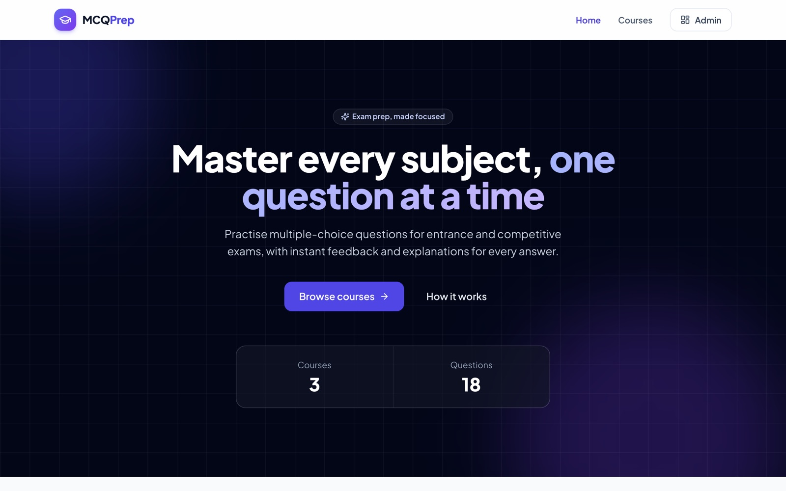
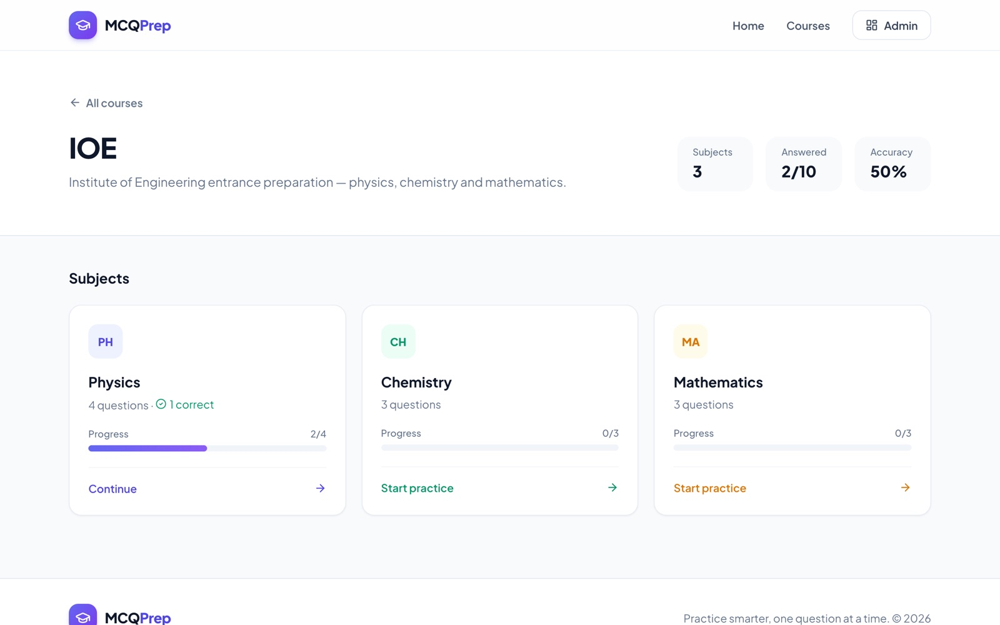
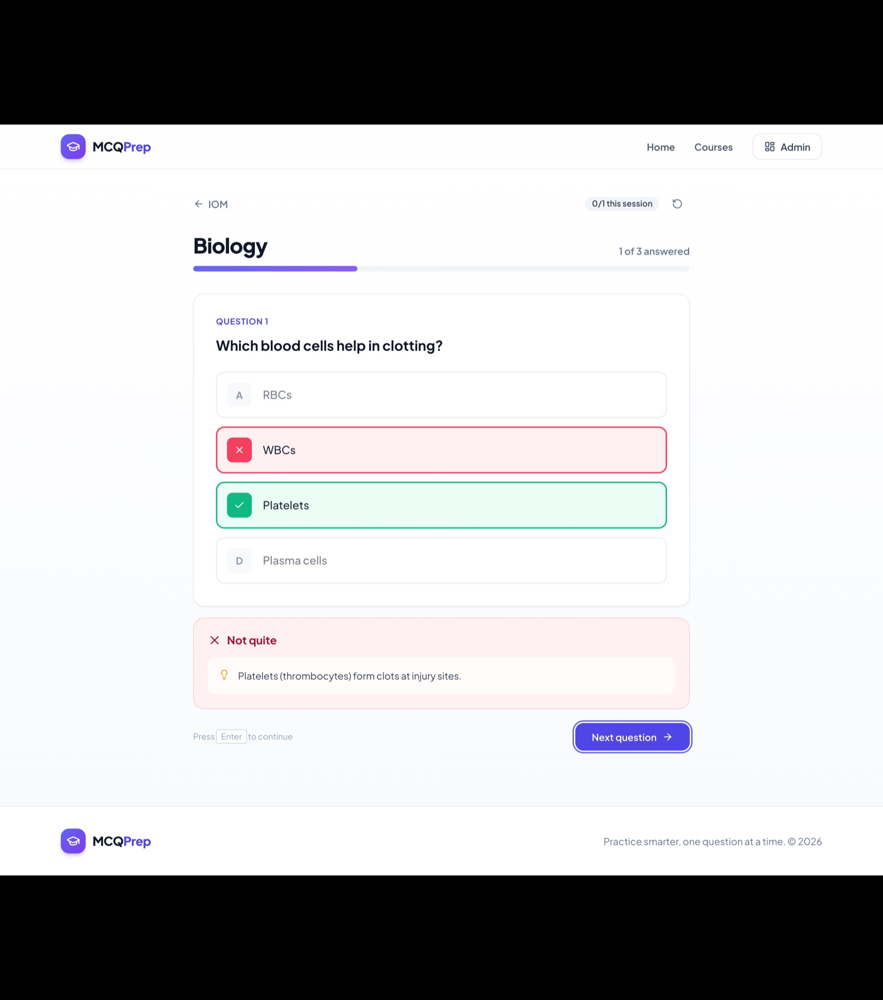
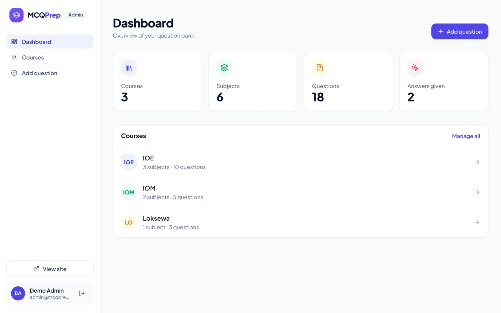
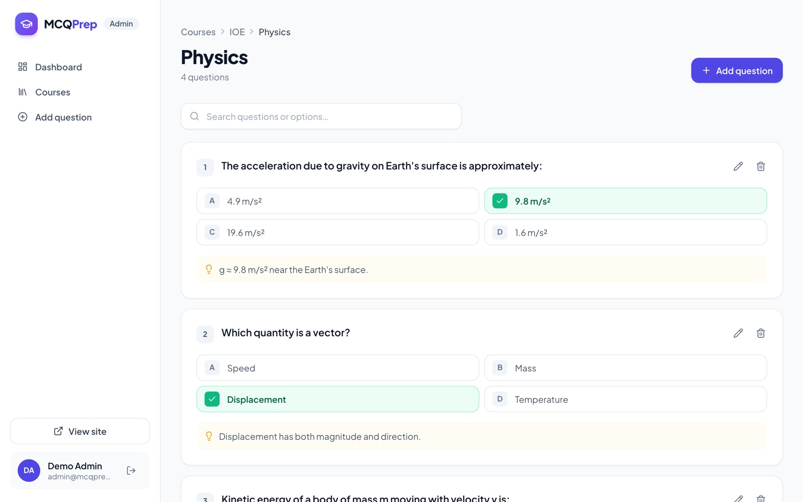
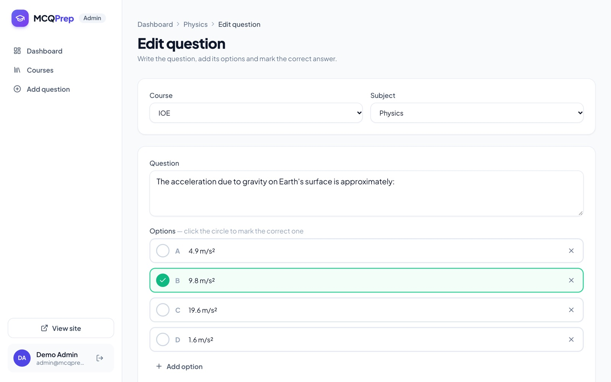
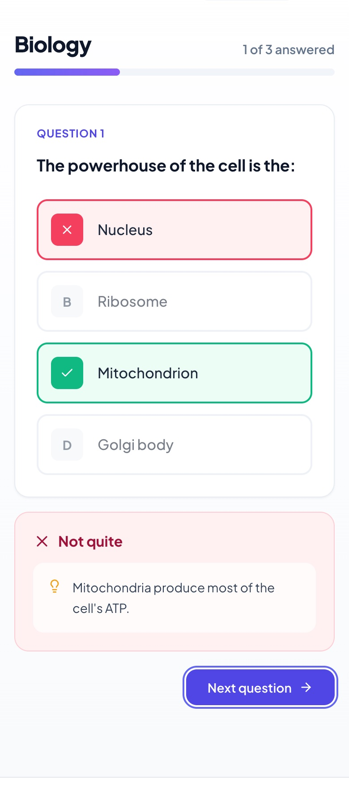
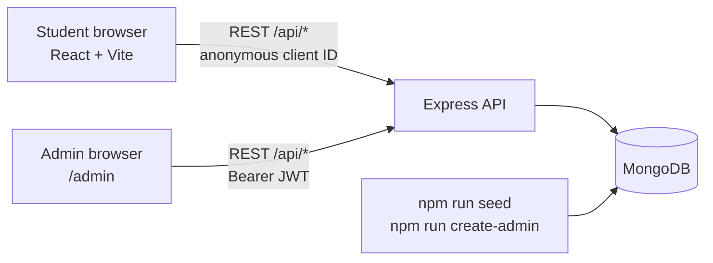
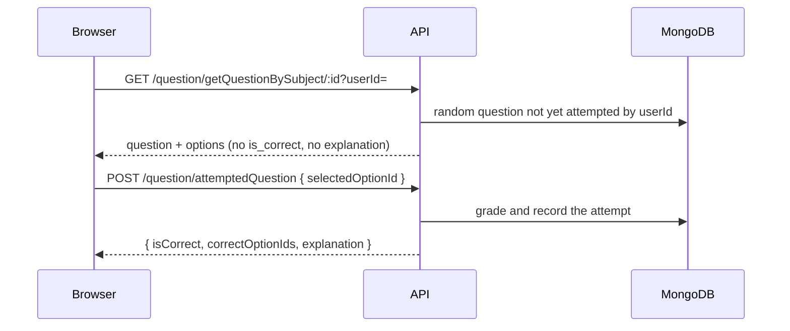
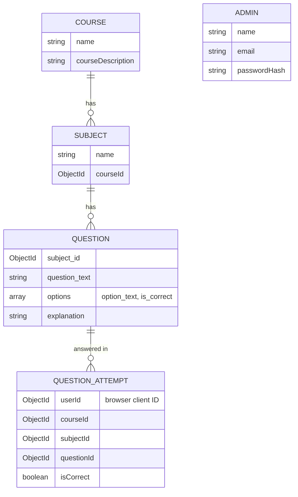

<div align="center">

# MCQPrep

**A full-stack MCQ practice app for entrance and competitive exams in Nepal (IOE, IOM, KU, Loksewa): pick a subject, answer questions you haven't seen yet, and get instant feedback with an explanation for every answer.**


[](LICENSE)



</div>

## Contents

- [Features](#features)
- [Screenshots](#screenshots)
- [Tech stack](#tech-stack)
- [How it works](#how-it-works)
- [Getting started](#getting-started)
- [Configuration](#configuration)
- [Project structure](#project-structure)
- [API reference](#api-reference)
- [Security](#security)
- [Roadmap](#roadmap)
- [License](#license)

## Features

### For students
- **Course → subject → quiz flow** with a clean, responsive UI that works on desktop and mobile.
- **No repeats**: each question is drawn at random from the ones you haven't answered in that subject yet.
- **Instant feedback**: the correct answer and its explanation appear as soon as you pick an option.
- **Progress tracking**: progress bars per subject, plus answered count and accuracy for each course.
- **Session stats**: score for the current session and a streak counter.
- **Practise again**: reset a subject to start it over.
- **Keyboard shortcuts**: press `A`–`F` or `1`–`6` to answer and `Enter` / `→` for the next question.

### For admins (`/admin`)
- **Login required**: email and password sign-in, with sessions that expire and access checked on every request.
- **Dashboard** with totals for courses, subjects, questions and answers given.
- **Courses and subjects**: create, edit and delete. Deleting one also deletes everything under it.
- **Question bank**: browse and search the questions in a subject, with the correct answers highlighted.
- **Question editor** with 2–6 options, one-click correct-answer marking, an optional explanation, and **Save & add another** for entering questions in bulk.

### Under the hood
- The client never receives answers before the student commits. The server checks the chosen option and only then reveals the correct one and the explanation.
- Validation on every write endpoint, consistent JSON errors, and a 404 handler for unknown routes.
- A seed script with sample IOE, IOM and Loksewa questions.

## Screenshots

| Course & subject progress | Answer feedback |
| --- | --- |
|  |  |
| **Admin dashboard** | **Question bank** |
|  |  |
| **Question editor** | **Mobile quiz** |
|  | <p align="center"></p> |

## Tech stack

| Layer    | Technology |
| -------- | ---------- |
| Frontend | React 18, Vite 5, React Router 6, Tailwind CSS 3, Axios, lucide-react |
| Backend  | Node.js, Express 4, Mongoose 8, JWT auth (jsonwebtoken), bcryptjs |
| Database | MongoDB (local or Atlas) |



## How it works

### Answering a question

The answer key stays on the server until the student has picked an option:



### Data model



### How progress is tracked

Students don't need accounts. On first visit, each browser gets a random 24-character ID, stored in `localStorage`, and all answers are recorded against it. Progress therefore follows the browser, not the person. Clearing site data starts fresh.

## Getting started

**Requirements:** Node.js 18+ and MongoDB running locally, or a MongoDB Atlas connection string.

```bash
git clone https://github.com/kushal721/MCQAPP_01.git
cd MCQAPP_01
```

### Backend

```bash
cd backend
npm install
cp .env.example .env      # then edit DATABASE_URL if needed
npm run seed              # optional: load sample courses & questions
npm run create-admin      # create your admin login (asks for email, name, password)
npm run dev               # API on http://localhost:4000 with auto-reload
```

`npm run seed` only seeds an empty database. To wipe everything and reseed, run `npm run seed -- --fresh`.

### Frontend

In a second terminal:

```bash
cd frontend
npm install
cp .env.example .env      # optional, only needed if the API isn't on localhost:4000
npm run dev               # Vite dev server on http://localhost:5173
```

Open **http://localhost:5173** to practise, or **http://localhost:5173/admin** to sign in and manage content.

### Admin accounts

There's no public sign-up. Admins are created from the command line, and the password is always typed at a prompt so it never lands in your shell history:

```bash
npm run create-admin                                        # prompts for everything
npm run create-admin -- --email you@example.com --name "You"
npm run create-admin -- --email you@example.com --reset     # change a password
```

Passwords must be at least 8 characters.

### Scripts

| Command | Where | What it does |
| ------- | ----- | ------------ |
| `npm run dev` | `backend/` | Start the API with nodemon |
| `npm start` | `backend/` | Start the API with node |
| `npm run seed` | `backend/` | Load sample IOE, IOM and Loksewa questions (`-- --fresh` to wipe first) |
| `npm run create-admin` | `backend/` | Create an admin or reset a password |
| `npm run dev` | `frontend/` | Start the Vite dev server |
| `npm run build` | `frontend/` | Production build into `frontend/dist` |
| `npm run preview` | `frontend/` | Serve the built files locally |

## Configuration

`backend/.env` (see [`backend/.env.example`](backend/.env.example)):

| Variable | Default | Description |
| -------- | ------- | ----------- |
| `DATABASE_URL` | `mongodb://127.0.0.1:27017/MCQ` | MongoDB connection string |
| `PORT` | `4000` | Port the API listens on |
| `CORS_ORIGIN` | `*` | Allowed frontend origin |
| `JWT_SECRET` | random per run in development | Signs admin sessions. **Required in production.** Without it, development sessions end on every restart. |
| `JWT_EXPIRES_IN` | `12h` | How long an admin stays signed in |

`frontend/.env` (see [`frontend/.env.example`](frontend/.env.example)):

| Variable | Default | Description |
| -------- | ------- | ----------- |
| `VITE_API_URL` | `http://localhost:4000/api` | Base URL of the backend |

## Project structure

```
MCQAPP_01/
├── backend/
│   ├── controllers/      # auth, course, subject, question, stats logic
│   ├── middleware/       # requireAdmin (JWT check)
│   ├── models/           # Mongoose schemas (Admin, Course, Subject, Question, QuestionAttempt, User)
│   ├── routes/           # Express routers mounted under /api
│   ├── seed.js           # sample data loader
│   ├── createAdmin.js    # create an admin / reset a password
│   └── index.js          # app entry point
├── frontend/
│   ├── index.html        # Vite entry HTML
│   ├── vite.config.js
│   └── src/
│       ├── main.jsx      # React entry point
│       ├── api.js        # all HTTP calls in one place
│       ├── components/   # layout + reusable UI (modal, toast, progress bar…)
│       ├── lib/          # hooks and helpers
│       └── pages/        # Home, CoursePage, QuizPage, NotFound, Admin/*
└── docs/screenshots/
```

## API reference

All routes are prefixed with `/api`. Routes marked 🔒 need an admin token in an `Authorization: Bearer <token>` header and return `401` without one.

<details>
<summary><strong>Auth</strong></summary>

| Method | Route | Description |
| ------ | ----- | ----------- |
| POST | `/auth/login` | `{ email, password }` → `{ token, admin }`. Returns 401 on bad credentials and 429 after 10 failures in 15 minutes. |
| GET | `/auth/me` 🔒 | The signed-in admin |

</details>

<details>
<summary><strong>Courses</strong></summary>

| Method | Route | Description |
| ------ | ----- | ----------- |
| GET | `/course/getAllCourse` | List courses with `subjectCount` and `questionCount` |
| GET | `/course/getCourse/:id` | Get one course |
| POST | `/course/addCourse` 🔒 | Create `{ name, courseDescription }` |
| PUT | `/course/updateCourse/:id` 🔒 | Update name and/or description |
| DELETE | `/course/deleteCourse/:id` 🔒 | Delete a course with its subjects, questions and attempts |

</details>

<details>
<summary><strong>Subjects</strong></summary>

| Method | Route | Description |
| ------ | ----- | ----------- |
| GET | `/subject/getSubjectByCourse/:courseId` | List a course's subjects with `questionCount` |
| GET | `/subject/getSubject/:id` | Get one subject (course populated) |
| POST | `/subject/addSubject` 🔒 | Create `{ name, courseId }` |
| PUT | `/subject/updateSubject/:id` 🔒 | Rename `{ name }` |
| DELETE | `/subject/deleteSubject/:id` 🔒 | Delete a subject with its questions and attempts |

</details>

<details>
<summary><strong>Questions</strong></summary>

| Method | Route | Description |
| ------ | ----- | ----------- |
| GET | `/question/getQuestionsBySubject/:subject_id` 🔒 | All questions in a subject, with answers |
| GET | `/question/getQuestion/:id` 🔒 | One question, with answers |
| POST | `/question/addQuestion` 🔒 | Create `{ subject_id, question_text, options: [{ option_text, is_correct }], explanation? }` |
| PUT | `/question/updateQuestion/:id` 🔒 | Update any of the fields above |
| DELETE | `/question/deleteQuestion/:id` 🔒 | Delete a question |
| GET | `/question/getQuestionBySubject/:subject_id?userId=` | A random unanswered question, **without** the answer. Returns 404 when the subject is finished. |
| POST | `/question/attemptedQuestion` | Submit `{ userId, courseId, subjectId, questionId, selectedOptionId }`. Returns `{ isCorrect, correctOptionIds, explanation }`. |
| GET | `/question/progress/:courseId?userId=` | `{ [subjectId]: { attempted, correct } }` |
| DELETE | `/question/resetProgress/:subject_id?userId=` | Clear a user's answers for a subject |

</details>

<details>
<summary><strong>Misc</strong></summary>

| Method | Route | Description |
| ------ | ----- | ----------- |
| GET | `/stats` 🔒 | Totals for the dashboard |
| GET | `/health` | Health check |

</details>

## Security

- Admin passwords are hashed with bcrypt and never returned by the API.
- Admin sessions are signed JWTs, checked by the server on every admin request.
- Login responses don't reveal which emails have accounts, and repeated failed logins are rate-limited.
- Answers and explanations are only sent after a student submits a choice.
- Secrets live in `.env`, which is git-ignored. Only `.env.example` is committed.

**Known limitations**
- The admin session token is kept in `localStorage`. That's simple, but a cross-site-scripting bug could read it. For a public deployment, consider moving it to an `httpOnly` cookie and serving the site over HTTPS.
- The login rate limit is kept in memory, so it resets when the server restarts and isn't shared between multiple server instances.

## Roadmap

- Student accounts and a leaderboard
- Timed mock tests mixing questions across subjects
- Bulk question import (CSV / JSON)

## License

[MIT](LICENSE) © 2024-2026 Kushal Bhatta
